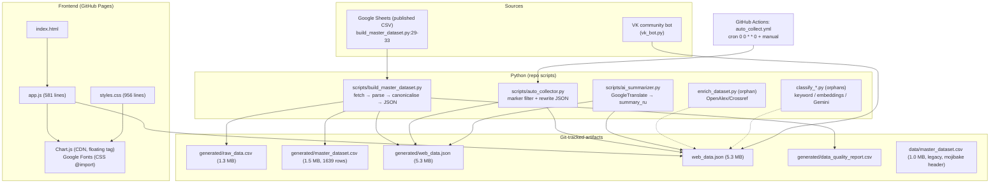

I have enough evidence. Here is the report.

---

# Olympic Research Hub — Product & Code Report

> **Review mode:** read-only. No files were created, modified, or deleted. Data profiling was done with streaming readers over the working tree. Repository state: branch `main` @ `9832792` (2026-10-11), 69 commits, clean working tree, 24 tracked files.

## 1. Executive Summary

**What the product is.** A single-page, static web catalogue of bibliometric records on Olympism and Olympic sport, with client-side search/filter/sort, three Chart.js dashboards, GOST-flavoured citation strings, CSV export, a favourites toggle, plus a set of Python "ETL" scripts, one weekly GitHub Actions job, and a VK community bot.

**Who it is for.** Russian-reading sports-science researchers/students looking for publications on Olympic topics, and (secondarily) the VK community around the project. The UI is entirely Russian (`index.html:2`, `lang="ru"`).

**Current maturity level.** **Late prototype / early MVP that is not internally consistent.** The frontend is coherent and polished for what it does, but the data layer is forked into two incompatible shapes, the automated pipeline in CI does not run the script the README documents, citation output is not actually GOST/APA, and the shipped dataset contains impossible years (up to 2200) and 1,556 records vs. 1,639 in the master CSV.

**Top 5 findings**

1. **Two incompatible data contracts, both in use.** `generated/web_data.json` is written as an object `{metadata, data}` by `scripts/build_master_dataset.py:160-167`, but is fully overwritten as a **bare array** by `scripts/auto_collector.py:52-57` and `scripts/ai_summarizer.py:44-50`. The shipped frontend file (1,556 records) is the legacy array shape; the master CSV holds 1,639 rows. The **1,556 figure in the README badge and header matches the stale file, not the source of truth.**
2. **The CI pipeline is a different pipeline from the documented one.** `auto_collect.yml` runs `scripts/auto_collector.py` (a local filter, not a collector) → `scripts/ai_summarizer.py` → `scripts/vk_bot.py`, and never runs `build_master_dataset.py`. It does not install `vk_api`, yet invokes `vk_bot.py` (`auto_collect.yml:23-26` vs `:48`, `scripts/vk_bot.py:6`).
3. **A live VK community token is hardcoded as a fallback default** in `scripts/vk_bot.py:14`, and it is committed. This is the single most urgent issue (see §8, §10-P0-1).
4. **Data quality is materially worse than the quality report claims.** `generated/data_quality_report.csv:2` says `records,1639` and `missing_year,76`; the shipped web dataset contains years such as `2027, 2036, 2100, 2115, 2200` and 2 `null` years, i.e. many more unusable rows than the report implies. "Leading countries" and "publications by year" charts are therefore misleading.
5. **Citation and export features are substantively broken relative to their labels.** Only one citation style exists (labelled GOST), APA claimed in the README (`README.md:16`) is absent, the access date is hardcoded (`app.js:131`), and only the first 400 chars of abstracts were ever translated — and for the shipped data the "Russian translation" is byte-identical to the English original.

---

## 2. Product Definition

### Problem solved
Olympic/sports-science literature is scattered across journals, conference proceedings and dissertations in several languages, with inconsistent metadata. The product offers one searchable, filterable catalogue with light bibliometric analytics and ready-made reference strings.

### Value proposition
- **One index, one search box** over titles/authors/abstracts (`index.html:42`, `app.js:284-288`).
- **Curated taxonomy** of 10 Olympic research directions (`app.js:14-26`) used for filtering and the donut chart.
- **Zero infrastructure**: static files over GitHub Pages; no backend, no auth, no database.
- **Russian-language access** to mostly English-language literature (intended; see §5 on whether it actually works).

### Target users and primary use cases
| User | Use case | Evidence |
|---|---|---|
| Student / early-career researcher | Find publications on a direction (e.g. "олимпийское образование"), copy a reference | `index.html:47-57`, `app.js:402-408` |
| Lecturer | Build a bibliography / reading list quickly | GOST copy button, CSV export (`app.js:558-577`) |
| Analyst / supervisor | See distribution by direction, year, country | `app.js:464-556` |
| VK community member | Query the same base from a chat bot | `scripts/vk_bot.py:78-144` |

### Key differentiators
The 10-direction Olympic taxonomy and Russian-language abstracts are the only genuine differentiators. Everything else (search, filters, charts) is table-stakes for a catalogue. **No competitor analysis, no user research, and no success metrics exist in the repo** — this is an assumption-driven product.

---

## 3. Feature Inventory

| Feature | Status | Evidence (file:line) | Notes |
|---|---|---|---|
| Static SPA shell (header, filters, analytics, feed, modal) | implemented | `index.html:10-168` | Single page, no routes |
| Dataset load with multi-path fallback | implemented | `app.js:36-62` | Tries `generated/web_data.json`, `data/web_data.json`, `web_data.json`; **no `data/` file exists** |
| Full-text search (title/abstract/authors) | implemented | `app.js:284-288` | Substring match in lowercase; no tokenisation, no diacritic/ё folding, no Cyrillic-Latin transliteration |
| Category filter (10 directions) | implemented | `app.js:146-156`, `:268-269` | Options are hardcoded, not derived from data |
| Document-type filter | implemented | `app.js:158-167`, `:271-272` | Values written as `item.type`; producer scripts never write `type` (see §5) |
| Country filter | partial | `app.js:86-97`, `:169-178` | Only 7 countries + "Другие страны"; anything else is collapsed |
| Language filter | partial | `app.js:75-84`, `:180-189` | `normalizeLanguage` returns "Другой язык" for Ukrainian → 20 records mis-bucketed |
| Year range filter | implemented | `app.js:262-263`, `:280-282` | Operates on a heuristic year extractor (`app.js:107-116`) |
| Sorting (year desc/asc, title) | implemented | `app.js:116-120`, `:294-303` | No citation-count or relevance sort |
| Pagination (60/page) | implemented | `app.js:7`, `:315-358` | Page numbers re-rendered on every filter change |
| Grid/List view toggle | implemented | `index.html:126-131`, `app.js:203-215`, `styles.css:354-395` | List view hides abstract + citation blocks (`styles.css:368-372`) |
| Analytics: doughnut by direction | implemented | `index.html:89-94`, `app.js:464-491` | Labels truncated to 16 chars (`app.js:481`); legend hidden, **no tooltips legend** on mobile |
| Analytics: line by year | implemented | `index.html:96-101`, `app.js:493-519` | Every distinct year is a data point → sparse/noisy line; includes implausible years |
| Analytics: horizontal bar "Ведущие страны" | implemented | `index.html:103-108`, `app.js:521-555` | Aggregated on the *already-normalised* 8-bucket country → effectively shows "Россия vs Другие страны" |
| "Найдено: N" counter | implemented | `index.html:121-123`, `app.js:305-306` | |
| Header total counter | implemented | `index.html:21-24`, `app.js:308-309` | Shows `rawData.length`, i.e. whatever file is loaded |
| Abstract expand/collapse in card | implemented | `app.js:394-400`, `:422-433`, `styles.css:480-486` | |
| Detail modal | implemented | `index.html:147-165`, `app.js:443-462` | Not keyboard accessible: no `Esc`, no focus trap |
| GOST citation generation | **partial** | `app.js:126-133` | Template is `Авторы. Название // Научная публикация. – Год. – URL: … (дата обращения: 11.10.2026)`; not conformant (see §6) |
| APA citation | **not implemented** | `README.md:16` claims it; no code | Search of `app.js` shows a single generator |
| Copy citation to clipboard | implemented | `app.js:135-144` | No `catch` → silent failure on non-HTTPS/insecure context |
| Favourites / favourites-only filter | **partial** | `app.js:3-4`, `:236-245`, `:435-441` | In-memory `Set` only; **`localStorage` is never used** (`grep` for `localStorage` in `app.js`: 0 hits) despite README `:17` |
| CSV export | implemented, fragile | `app.js:558-577` | See §6 for encoding/quoting defects |
| VK group link in header | implemented | `index.html:27-32` | Points to `vk.ru/club242169366` |
| VK bot (search/stats/random) | implemented, undeployed | `scripts/vk_bot.py:78-171` | Never installed in CI; token hardcoded |
| ETL: curated CSV → master → web JSON | implemented | `scripts/build_master_dataset.py:141-177` | **Never executed by CI** |
| ETL: Olympic-marker filtering | implemented | `scripts/auto_collector.py:8-57` | Filters, does not collect; destroys the `{metadata,data}` envelope |
| ETL: Google Translate of abstracts | partial/broken | `scripts/ai_summarizer.py:7-54` | Truncates to 4000 chars; shipped `summary_ru` == English original |
| ETL: OpenAlex/Crossref enrichment | implemented, orphaned | `enrich_dataset.py:45-114`, `:131-204` | Not referenced by CI or README |
| Classification: keyword scoring | implemented, orphaned | `classify_dataset.py:16-76` | Root-level, unreferenced |
| Classification: local embeddings | implemented, orphaned | `classify_local_vector.py:11-59` | Requires `sentence-transformers` (~470 MB), no `requirements.txt` |
| Classification: Gemini LLM | implemented, orphaned | `classify_with_ai.py:9`, `:87-155` | User is prompted for an API key interactively (`:95`) — cannot run in CI |
| Dataset audit script | implemented | `check_accuracy.py:31-58` | Prints 15 random samples; not automated |
| Schema inspection script | implemented | `inspect_json.py:1-16` | Dev utility |
| Automated weekly refresh | **partial** | `auto_collect.yml:3-48` | Runs, but runs the wrong scripts (see §7) |
| GitHub Pages deployment | **unknown** | No `pages` job, no `gh-pages`, no `docs/` | Either configured in repo settings (branch deploy) or not deployed from this repo |
| `data/web_data.json` fallback path | not implemented | `app.js:37`, `scripts/vk_bot.py:19` | Path is probed but no such file exists |
| Open question: "planned" features | unknown | — | No roadmap/issue tracker in repo |

---

## 4. Architecture & Tech Stack

### High-level architecture (as built)



### Frontend
- **HTML5 + CSS Grid + vanilla ES2017+**; no build step, no bundler, no framework (`index.html:167` single `<script src="app.js">`).
- **Chart.js from a floating CDN tag** (`index.html:8`, `https://cdn.jsdelivr.net/npm/chart.js` — no version pinned). If the CDN is blocked, `updateCharts` silently returns (`app.js:465`).
- **Fonts** loaded via CSS `@import` in `styles.css:1` (render-blocking; can't be preloaded).
- **State**: five module-level `let` variables (`app.js:1-8`) + `window.*` functions for `onclick` attributes. No router, no URL state, no persistence.

### Data layer
Plain JSON files committed to git. 5.3 MB each, duplicated twice (`web_data.json` and `generated/web_data.json` are byte-identical by inspection: both 1,556 records, both array-rooted).

### Python scripts
| Script | Location | Role | Wired to CI? |
|---|---|---|---|
| `build_master_dataset.py` | `scripts/` | Real ETL: Sheets → master + web JSON + QA report | **No** |
| `auto_collector.py` | `scripts/` | Marker filter over existing JSON | Yes |
| `ai_summarizer.py` | `scripts/` | Translation | Yes |
| `vk_bot.py` | `scripts/` | Long-poll bot | Yes (but dependency missing) |
| `enrich_dataset.py` | repo root | OpenAlex/Crossref enrichment | No |
| `classify_dataset.py` | repo root | Keyword classifier | No |
| `classify_local_vector.py` | repo root | Embedding classifier | No |
| `classify_with_ai.py` | repo root | Gemini classifier | No |
| `check_accuracy.py`, `inspect_json.py` | repo root | Dev utilities | No |

### CI/CD & hosting
Single workflow `.github/workflows/auto_collect.yml` (48 lines). No Pages workflow, no tests workflow, no lint workflow.

### Key dependencies and versions
| Dependency | Version pin | Where |
|---|---|---|
| Python | `3.10` in CI (`auto_collect.yml:21`) vs `3.11` in README badge (`README.md:6`) | mismatch |
| `requests`, `deep-translator` | unpinned (`auto_collect.yml:26`) | **`requests` is never imported by any CI script** |
| `vk_api` | not installed at all | required by `scripts/vk_bot.py:6` |
| `google-genai` | not declared anywhere | `classify_with_ai.py:4` |
| `sentence-transformers`, `numpy` | not declared | `classify_local_vector.py:4-5` |
| Chart.js | **unpinned CDN** | `index.html:8` |
| **No `requirements.txt`, no `package.json`, no lockfile** | — | verified: no such files tracked |

### Coupling and modularity assessment
- **Frontend ↔ data contract is the tightest coupling and the weakest link.** `app.js` defensively accepts many key aliases (`title_original || title`, `summary_ru || summary || abstract`, `item.year || item.publication_year || item.date`) — `app.js:100, 108, 128, 368` — which is a symptom, not a design.
- **Producers disagree with the consumer**: `build_master_dataset.py` emits `document_type`, `year_numeric`; `app.js` reads `type`, `year` (`app.js:271, 108`). **No producer emits `type`**, yet the document-type filter keys on it.
- **Python scripts are copy-paste siblings**: the same `POSSIBLE_PATHS` list and the same "load list-or-envelope" dance is duplicated in at least six files (`classify_dataset.py:4-8, 87-88`; `check_accuracy.py:5-6, 39`; `enrich_dataset.py:8-18, 109-110`; `classify_local_vector.py:7-8`; `classify_with_ai.py:6-7`; `scripts/vk_bot.py:17-29`). No shared module.
- **Category list is duplicated four times**: `app.js:14-26`, `classify_dataset.py:17-57`, `classify_local_vector.py:11-32`, `classify_with_ai.py:11-22`. Adding an 11th direction requires four coordinated edits.
- Overall: **low modularity, high duplication, no single source of truth for schema or taxonomy.**

---

## 5. Data Model & ETL Pipeline

### 5.1 Two schemas

**(A) Curated source schema** — 22 Russian fields, enforced by `EXPECTED_FIELDS` (`scripts/build_master_dataset.py:35-41`) and mapped to canonical English keys (`:43-54`):

```text
ID, Автор, Год, Страна, Университет / организация, Тип документа, Уровень,
Название (оригинал), Язык, Научная дисциплина, Основное направление,
Вторичное направление, Методология, DOI, URL, Источник, Статус верификации,
Уровень релевантности, Причина включения, Контейнер (журнал/издательство),
Цитируемость, Примечание
↓
study_id, authors, year, country, institution, document_type, academic_level,
title_original, language, discipline, primary_topic, secondary_topic,
methodology, doi, url, source, verification_status, relevance,
inclusion_reason, container, citation_count, notes
+ derived: doi_normalized, title_normalized, author_normalized, year_numeric
```

The actual raw CSV header matches exactly (`generated/raw_data.csv`, line 1 = `ID,Автор,Год,...`), and `master_dataset.csv` line 1 matches the canonical + derived set. **This part of the pipeline is sound.**

**(B) Shipped frontend schema** — array of flat objects. Verified by direct inspection of `web_data.json` lines 2-17:

```json
{
  "title": "DISEÑO Y VALIDACIÓN DE UNA SECUENCIA DIDÁCTICA …",
  "title_original": "…",
  "summary": "This research focuses on …",
  "abstract": "This research focuses on …",   // duplicate of summary
  "authors": "Grey Sánchez Ducuara, Néstor Willian Aponte López, …",
  "year": 2026,
  "category": "Подготовка олимпийского резерва и тренировка",
  "discipline": "Подготовка олимпийского резерва и тренировка",  // duplicate of category
  "type": "Научная статья",
  "country": "Другие страны",
  "language": "Испанский",
  "url": "https://openalex.org/W7217958946",
  "summary_ru": "This research focuses on …",  // NOT Russian — identical to summary
  "summary_original": "This research focuses on …"
}
```

Key structural facts (streaming counts over both `web_data.json` and `generated/web_data.json`, identical results):
- 1,556 records; `category` ×1556, `discipline` ×1556, `summary_ru` ×1556, `year` ×1556
- `document_type` ×0, `study_id` ×0, `metadata` ×0 → **schema B has none of schema A's identifiers**

### 5.2 Collection → cleaning → enrichment → JSON → frontend

**Path 1 (documented, `README.md:25-41`)** — Sheets → `build_master_dataset.py` → `generated/web_data.json` → frontend.
Implementation: `fetch` Google Sheets published CSV (`:146-147`, default URL hardcoded `:29-33`) → `parse_csv` validates headers against `EXPECTED_FIELDS` and drops all-empty rows (`:79-93`) → `to_master` normalises DOI/text/year/citation count with per-field `try/except` (`:95-111`) → writes `raw_data.csv`, `master_dataset.csv` (`utf-8-sig`), `web_data.json` **as `{metadata, data}`** (`:160-169`), and `data_quality_report.csv` (`:171-173`).

**Path 2 (actually automated, `auto_collect.yml`)** — reads the *already-committed* `web_data.json`, filters it, translates it, commits it back.
`auto_collector.py:28-57` filters on `OLYMPIC_MARKERS` (`:8-16`) and rewrites both JSON files **as a bare array** (`:52-57`). It has no network collection at all despite the filename and the workflow step name "Запуск сбора исследований" (`auto_collect.yml:28`).

**Consequence.** The `{metadata, data}` envelope, `study_id`, `document_type`, `year_numeric` and QA report produced by Path 1 are silently dropped by Path 2. The QA report is now stale relative to the shipped data.

### 5.3 Data quality — measured, not assumed

Distribution of the shipped 1,556 records:

| Dimension | Observed values |
|---|---|
| Category | Теория и методология **801** (51%), Олимп. образование 168, Подготовка резерва 156, Этика 117, История 111, Менеджмент 84, Пропаганда 53, Психология 35, Спорт. медицина 16, Политика 15 |
| Country | Россия 1260, Другие страны 222, Украина 34, Китай 8, Беларусь 6, США 5, … |
| Language | Русский 1253, Английский 282, Украинский 20, Испанский 1 |
| Document type | Научная статья 1273, Монография 248, Материалы конференции 21, Обзорная 11, Диссертация 3 |
| URL host | doi.org 1493, openalex.org 63 |
| Year | valid ≤2026: **~907**; **invalid or in the future: ~649** (incl. 2027×563, 2036×17, 2115×24, 2116×14, 2100×5, 2200×1, `null`×2) |

**Critical quality problems, all evidence-backed:**

1. **Class imbalance from a biased fallback.** `classify_dataset.py:72-74` assigns every zero-score record to *"Теория и методология олимпийского движения"*. That is exactly the pattern observed (801/1556). The donut chart is therefore close to meaningless as a description of the field.
2. **Year corruption.** 2027×563 etc. are almost certainly **page numbers or year-like tokens parsed from citation strings**, not publication years. The frontend's `extractYear` (`app.js:107-116`) will happily return them, so "Сначала новые (по году)" puts 2200 and 2115 publications above real 2025 ones, and the year line chart (`app.js:496`) includes them because its guard is `y <= 2026`… yet the *stored* data already contains them and `updateCharts` filters them out for the line but **not** for the sort. Sorting is wrong; the chart is silently gapped.
3. **`summary_ru` is not a translation.** Inspected record 1 and record 2: `summary_ru` is character-identical to the English `summary`. `ai_summarizer.py:35` only translates when `summary_ru` is absent — so once the field is populated (even with untranslated text), translation never runs again. Combined with `ai_summarizer.py:14-15` truncating to 4,000 chars, the "Russian abstracts" promise is unfulfilled.
4. **`document_type` is missing but `type` is present.** The shipped records carry `type` (English-free Russian labels), yet `build_master_dataset.py` emits `document_type`. So the shipped file is **not** a product of the current `build_master_dataset.py`; it is a legacy file that the classifier scripts (`classify_dataset.py:100`, `classify_with_ai.py:131`) and the enrichment script (`enrich_dataset.py:156`) patched in place. **Provenance of the shipped dataset cannot be reconstructed from the repo.**
5. **Duplicated payload.** `summary` ≡ `abstract`, `category` ≡ `discipline`, `summary_ru` ≡ `summary_original` ≡ `summary`. Roughly 40% of the 5.3 MB payload is redundant (see §8 performance).
6. **Legacy mojibake file tracked.** `data/master_dataset.csv` line 1 decodes as `ID;?????;??;??????;...` — a Windows-1251 export, tracked in git, unused by any script.

### 5.4 Validation gaps and reproducibility

- **Good**: header validation with explicit error (`build_master_dataset.py:84-87`); empty-row pruning (`:91-92`); QA metrics for missing/duplicate IDs and missing titles/years (`:113-129`).
- **Missing**:
  - No **duplicate-title / duplicate-DOI** detection (only `duplicate_id`, `:119`).
  - `missing_year` counts `not re.fullmatch(r"\d{4}", year)` (`:121`), which accepts **2200** as valid. The metric is definitionally incapable of catching the observed defect.
  - No year **range** check (1850–current).
  - No URL/DOI well-formedness check.
  - No schema check on `year_numeric` vs `year`.
  - `quality_report` only runs in the orphaned Path 1, so it is not a gate.
- **Reproducibility**: the pipeline depends on an unversioned, hardcoded Google Sheets URL (`:29-33`) that can be edited by anyone with the link; on Google Translate (`ai_summarizer.py:12`) whose output is non-deterministic; and on a Gemini model name `gemini-3.8-flash` (`classify_with_ai.py:9`) that cannot be verified to exist. **Nothing in the repo can regenerate the shipped 1,556-record file.**

---

## 6. Frontend & UX

### Page structure and rendering
Header (logo, title, count badge, VK link) → sticky filter bar → 3 analytics cards → toolbar (sort, view toggle, count) → card feed → pagination → modal. `styles.css:78-86` makes the filter bar `position: sticky; top: 0` inside a page whose header is *not* sticky — so filters float over content with no backdrop.

Rendering is **full innerHTML replacement per render**: `container.innerHTML = items.map(renderGridCardHtml).join('')` (`app.js:333`), plus a complete page-button rebuild (`app.js:346-357`) and a full Chart destroy/recreate cycle (`:477, 502, 533`). No virtualisation; 60 cards per page × ~2 KB of HTML each.

### Search/filter behaviour
- `applyFilters()` (`app.js:255-313`) re-scans **all** records and then **mutates `filteredData` in place with `.sort()`** (`:294`). `filteredData` is only re-derived from `rawData` inside the filter, so this is currently safe — but it is fragile: any future code that holds a reference to the previous array will be silently reordered.
- Search is `String.includes` on a lowercased concatenation (`:288`). `ё`/`е`, `й`/`и`, transliteration, and punctuation are not normalised, although the *Python* side does normalise `ё→е` (`build_master_dataset.py:60`). Russian-language search quality will be inconsistent.
- Every keystroke triggers the whole pipeline (`app.js:193`): filter + sort + 60-card render + **three Chart.js rebuilds**. No debounce.

### Chart.js usage
Three charts, all rebuilt from scratch on every filter change. The year line chart (`:493-519`) plots **every distinct year as a category label**, so with sparse early data you get hundreds of x-axis labels and a jagged line. Category labels are truncated to 16 characters (`:481`) with `+ '...'`, which produces several visually identical slices (e.g. "Спортивная медици…", "Политика, геопол…"). The country bar chart (`:521-555`) aggregates on `normalizeCountry`, which has already collapsed everything outside 7 named countries into "Другие страны" (`:96`) — so this chart is *structurally* capped at 8 categories and its title ("Ведущие страны") overstates what it shows.

### Citation generation logic
```js
// app.js:126-133
let citation = `${authors}. ${title} // Научная публикация. – ${year}. – URL: ${originalUrl} (дата обращения: 11.10.2026).`;
```
Problems, in order of severity:
1. **The access date is hardcoded to 11.10.2026** — a literal in the template, not `new Date()`. Every citation ever produced will be dated that day.
2. **"// Научная публикация"** is a placeholder for the container/journal. Real GOST requires the actual source. The data *does* contain `Источник`/`Контейнер` in the master CSV — it is simply not projected into the web JSON (`build_master_dataset.py:133-138` keeps `container`, but the shipped legacy file has no such field).
3. **No author normalisation to GOST format** ("Фамилия И. О."), no page range, no volume/issue, no publisher place. For books/dissertations (`type: Монография` ×248, `Диссертация` ×3) the template is categorically wrong.
4. **APA is absent**, despite `README.md:16`.
5. `getOriginalUrl` (`:118-124`) silently falls back to a **Google Scholar search URL** when no URL exists, and that fallback is then printed *inside the citation as if it were the source URL*.
6. `copyGostCitation` has no `.catch` (`:139-143`); on a non-secure origin the promise rejects and the button never confirms.

### CSV export
`exportToCSV` (`app.js:558-577`):
- Builds a `data:text/csv;charset=utf-8,` URI and passes it through `encodeURI` (`:570`). `encodeURI` does **not** encode `#`, and it percent-encodes Cyrillic — Chrome truncates at `#` in data URIs, and Excel will show percent escapes rather than text unless a BOM is present. **No UTF-8 BOM is emitted** (`:559`), so opening in Excel on Windows produces mojibake for the Cyrillic headers — the exact failure the repo already demonstrates in `data/master_dataset.csv`.
- Escapes `"` but **not newlines inside fields**; a title containing a line break breaks the row structure.
- Ignores the current **sort order**… actually it preserves `filteredData` order, which is fine — but it exports the *entire filtered set*, not the current page, while the button label gives no hint (`index.html:78-80`).
- File naming already accounts for favourites (`:573`) — good detail.

### localStorage favourites
**Not implemented.** `favorites` is a `Set` of array indices (`app.js:3`), re-populated empty on every page load. There is **zero** reference to `localStorage` anywhere in `app.js` (verified by search). Worse, the key is the **array index** (`:376`), so if the dataset is ever regenerated (which the weekly cron does), saved indices would point at different publications even if persistence were added later. README `:17` is inaccurate.

### Accessibility and responsive design
**Responsive:** three breakpoints (`styles.css:699-723`, `:837-847`, `:938-956`): 3→2→1 cards, analytics stack at 1100px, header stacks at 900px. Reasonable, though several hand-tuned `px` font sizes (9.5px, 10px, 11px at `styles.css:425, 494, 464`) fall below comfortable reading size.

**Accessibility — significant gaps:**
- Modal (`index.html:147-165`) has **no `role="dialog"`, no `aria-modal`, no focus management, no `Esc` handler** (`app.js:249-252` only binds close-button and overlay click).
- Card titles are `<h3 onclick=…>` (`app.js:389`) — clickable non-interactive elements, unreachable by keyboard, no `tabindex`, no `role="button"`.
- The favourite star (`app.js:384`) is a `<button>` with no accessible name beyond `title="В избранное"` and no `aria-pressed`.
- Pagination uses `onclick` strings on buttons (`app.js:346-356`) — keyboard-focusable, but no `aria-current`.
- Images have `alt` text (`index.html:15`); the VK SVG has no `aria-hidden`/`role`.
- Colour-only state for favourites (gold vs `#ccc` star, `app.js:384`).
- No skip link, no `<main>` landmark on the feed? — `index.html:135` does use `<main>`, good.
- No `prefers-reduced-motion` for card hover transforms (`styles.css:411-415`).

---

## 7. Automation, CI/CD & Deployment

### Workflow: `.github/workflows/auto_collect.yml`

| Aspect | Detail | Evidence |
|---|---|---|
| Name | "Автоматический сбор олимпийских исследований" | `:1` |
| Triggers | weekly cron `0 0 * * 0` (Sunday 00:00 UTC) + `workflow_dispatch` | `:3-6` |
| Permissions | `contents: write` | `:11-12` |
| Runner | `ubuntu-latest`, Python `3.10` | `:10, :19-21` |
| Deps | `requests`, `deep-translator` (unpinned) | `:23-26` |
| Step 1 | `python scripts/auto_collector.py` | `:28-30` |
| Step 2 | `python scripts/ai_summarizer.py` | `:32-34` |
| Step 3 | commit+push `web_data.json` + `generated/web_data.json`, bot identity `bot@olympic-hub.ru` | `:36-41` |
| Step 4 | `python scripts/vk_bot.py` with `VK_BOT_TOKEN`, `VK_USER_ID` secrets | `:43-48` |

### Failure modes (all deterministic, not hypothetical)

1. **Step 4 always fails.** `vk_api` is never installed (`:26` installs only `requests`, `deep-translator`), and `scripts/vk_bot.py:6` imports `vk_api`. If `VK_BOT_TOKEN` is unset, the hardcoded fallback in `vk_bot.py:14` is used instead — masking the configuration error.
2. **Step 4 would hang anyway.** `vk_bot.py:157` enters `longpoll.listen()` — an infinite loop. In CI this runs until the job's 6-hour timeout. It is a **daemon, not a notifier**, despite the step name "Уведомление в ВКонтакте" (`:43`). `VK_USER_ID` is read into the environment (`:46`) but **never used anywhere in the script**.
3. **`git push` fails on re-runs and on protected branches.** `:41` pushes without `git pull --rebase`; if the branch moved between checkout and push, the job fails. `actions/checkout@v4` (`:16`) leaves no retry.
4. **Commit condition is convoluted but functional**: `git diff --quiet && git diff --staged --quiet || (commit && push)` — after `git add`, `git diff` (unstaged) is empty, so the second clause governs. It works, but reads as an accidental pattern.
5. **No concurrency guard.** Two overlapping runs (cron + manual dispatch) will race on the same files; `ai_summarizer` reads-modify-writes `web_data.json` with no locking.
6. **No failure isolation.** If `auto_collector.py` writes partial output, `ai_summarizer.py` still runs, and the commit still happens.
7. **Translation volume.** `ai_summarizer.py` has **no rate-limit handling and no per-run cap**; `deep_translator.GoogleTranslator` will be throttled/banned on a 1,556-record backfill, and each exception just prints and moves on (`:17-19`), leaving `summary_ru` as the original — which is precisely the state of the shipped data.
8. **Secrets inventory.** `VK_BOT_TOKEN`, `VK_USER_ID` are referenced; `GEMINI_API_KEY` is used only by the interactive, non-CI `classify_with_ai.py:93`. **None are leaked in the workflow file.** However, see §8-4.

### GitHub Pages deployment
**There is no Pages workflow in the repo** (only `auto_collect.yml` exists in `.github/workflows/`). Deployment is therefore either (a) configured out-of-band via Settings → Pages → "Deploy from a branch" on `main`, or (b) not deployed from this repository at all. Both are plausible; (a) is consistent with the site being a plain static file set at repo root and with the README's "static + GitHub Pages" claim. **This is a documented assumption, not a verified fact.**

**Operational risk of that model:** every push to `main` (including the weekly bot commit) is a production deploy of both the data file *and* the frontend. There is no staging environment, no preview, no smoke test.

### Reproducibility
CI does not pin dependencies (no lockfile, no `requirements.txt`), does not pin Python vs. README, and does not run the script that actually builds the structured dataset. Two different "current" datasets therefore circulate and neither is regenerable.

---

## 8. Quality Assessment

### Code organisation and readability
- `app.js` (581 lines) and `styles.css` (956 lines) are readable and consistently formatted; Russian comments are useful (`app.js:202, 293`; `styles.css:35, 77, 551, 588`).
- **Dead CSS**: the file contains three successive header implementations (`styles.css:36-55 .site-header`, `:725-773 .vk-header-link`, `:776-800 .site-header-image-banner`, `:850-956 .site-header-modern`). Only the last is used by `index.html:13`. Similarly `.logo-area`, `.logo-icon`, `.db-stat-top` (`:45-75`) are orphaned. Roughly 30% of the stylesheet is dead.
- `header.html` is a **stale, unused partial** — it references `header-banner.png` (file on disk is `header_banner.png`, and it is not referenced by `index.html` either) and a **different VK club id** (`club233282205`, `header.html:14`) than the live one (`club242169366`, `index.html:27`). Also still contains a hardcoded `1556` (`header.html:10`).
- Root-level script sprawl: 6 Python files at repo root, 4 in `scripts/`, no `__init__.py`, no shared `common.py`.
- Emoji-heavy log output and Russian inline prose in scripts is friendly but not machine-parseable.

### Error handling and logging
| Location | Behaviour | Verdict |
|---|---|---|
| `app.js:40-53` | `catch {}` empty, "Ищем по следующему пути" | Acceptable for fallback, but swallows JSON parse errors that would indicate a corrupt file |
| `app.js:55-61` | Renders a red error card on total failure | Good |
| `app.js:139-143` | Clipboard promise with no `.catch` | Silent failure |
| `build_master_dataset.py:102-109` | `except Exception` → empty/0 | Loses the reason; `year_numeric` silently becomes `""` |
| `enrich_dataset.py:61-62, 81-82` | `except Exception: pass` on HTTP | Discards all diagnostics; impossible to tell "no result" from "rate-limited" |
| `ai_summarizer.py:17-19` | prints and returns original text | Silently degrades to untranslated data (observed in shipped file) |
| `classify_with_ai.py:67-85` | retry with backoff on 429 | **Best error handling in the repo** |
| `vk_bot.py:10-11` | `logging.basicConfig(INFO)` | Good |
| Frontend logging | `console.error` only (`app.js:56`) | No telemetry, no way to know the site is broken for users |

### Performance and scalability
- **5.3 MB JSON** loaded and fully parsed before first paint is possible (`app.js:28-33` awaits `loadDataset` before rendering). On a 3G connection this is a multi-second blank page. No loading indicator — the header shows `...` (`index.html:23`) and the feed is empty.
- **~2.1 MB of the payload is duplicated fields** (`summary`≡`abstract`, `category`≡`discipline`, `summary_ru`≡`summary_original`). A projection removing the duplicates and renaming to the canonical schema would roughly halve the file.
- No gzip/brotli at the source — GitHub Pages does compress, which mitigates this substantially (unverified, but expected).
- Three Chart.js rebuilds per keystroke with no debounce (`app.js:193`, `:312`). At 5,000 records this becomes visibly janky.
- Card rendering re-serialises 60 cards on every filter tick, discarding and re-creating DOM (`app.js:333`).
- **Scalability ceiling**: the design (full dataset in memory, client-side filter) is fine to ~20–50k records; beyond that you need an index (client-side trie/Fuse.js, or a static search index like Pagefind/Lunr).
- CDN Chart.js unpinned (`index.html:8`) — any major bump can break all three charts with no warning.

### Security and privacy
1. **P0 — Hardcoded VK token.** `scripts/vk_bot.py:14` contains a literal `VK_GROUP_TOKEN` default (`vk1.a.OAoA…5wkyw`). It is committed and pushed. **Redacted here.** Any holder can post/spam as the community. It must be treated as **already compromised** — revoke and rotate in VK admin, then remove the fallback and fail hard when the env var is absent.
2. **CI step that runs a long-poll daemon** (`:157`) means a leaked token is exercised on every scheduled run.
3. **No Content-Security-Policy, no `rel="noopener"`** on `target="_blank"` links (`index.html:27`, `app.js:414`) — reverse tabnabbing exposure on the outbound "Оригинал" links.
4. **HTML injection surface.** Card HTML is built by template literal (`app.js:380-419`). `title`, `authors`, `summary`, `category` go through `escapeHtml` (`:579-581`) — **good** — but `originalUrl` is interpolated **raw** into `href="${originalUrl}"` (`app.js:414`) with **no protocol validation**. `getOriginalUrl` (`:119-120`) only checks `startsWith('http')`, so `http://foo" onclick="…` style payloads from an untrusted CSV cell could break out of the attribute. The dataset is editor-controlled, so this is low-likelihood/high-impact rather than remote exploitation — but it is a real defect in a pipeline that ingests data from a shared Google Sheet and OpenAlex/Crossref.
5. **Third-party data sent to machine translation.** `ai_summarizer.py:12` sends every abstract to Google Translate, and `classify_with_ai.py` sends title+abstract to Gemini. This is public bibliographic text, so privacy risk is low, but there is **no disclosure** anywhere in the README or UI.
6. **Personal data**: author names are published (expected for bibliometrics). No emails, ORCIDs, or reviewer identities are stored. **No privacy policy exists** — for a public scholarly catalogue in RU jurisdiction that is a compliance gap (152-ФЗ) worth flagging to the owner, not necessarily a code defect.
7. **No auth whatsoever.** Fine for a public catalogue; fatal if the Sheets edit access is not restricted.

### Test coverage and QA gaps
- **Zero automated tests.** No `tests/`, no `pytest`, no Jest/Playwright, no CI test step.
- Manual scripts substitute for tests: `check_accuracy.py` prints 15 random samples (`:45`), `inspect_json.py` prints one record — neither asserts anything, neither is wired to CI.
- No fixture data, no golden-file test for the citation generator or CSV export.
- No linting/formatting config (no `.eslintrc`, no `ruff.toml`, no `.editorconfig`).
- No accessibility or Lighthouse run.
- **QA gap that matters most**: nothing validates that the file the frontend loads has the shape the frontend expects. This is exactly the class of bug that produced the current inconsistency.

### Documentation quality
`README.md` is 41 lines. It has a good feature list (`:12-19`) and a clear pipeline diagram (`:25-41`), but:
- It **ends at line 41** — there is no installation, no local run instructions, no script reference, no data schema, no configuration/environment-variable table, no contribution guide, no licence text (the MIT badge at `:5` has no corresponding `LICENSE` file), and no roadmap.
- Several claims are **not true of the code**: "APA" (`:16`), "`localStorage`" (`:17`), "Поиск по … категориям" (the category field is exact-match only, `app.js:269`), "Автоматический сбор" (`:19` — no collection happens), "1639 studies" (`:8` — the shipped file has 1556), Python 3.11 (`:6` — CI uses 3.10).
- `header.html` implies a header partial that is neither included nor current.

---

## 9. Risks & Technical Debt

| Risk | Severity | Evidence | Impact | Suggested mitigation |
|---|---|---|---|---|
| VK bot token committed in source | **Critical** | `scripts/vk_bot.py:14` | Anyone can act as the community; token is in git history | Revoke token in VK → remove default → `raise SystemExit` if `VK_GROUP_TOKEN` missing → purge history or rotate-and-accept |
| CI invokes a never-terminating daemon | **Critical** | `auto_collect.yml:43-48`, `scripts/vk_bot.py:157` | Every scheduled run burns up to 6 h of runner time and fails; masks real failures | Remove the step or replace with a bounded "post once" notifier |
| `vk_api` missing from CI deps | High | `auto_collect.yml:26` vs `vk_bot.py:6` | Step 4 always fails | Add `requirements.txt` and `pip install -r` |
| Two incompatible JSON contracts in one pipeline | **High** | `build_master_dataset.py:160-167` vs `auto_collector.py:52-53` | Envelope/`study_id`/`document_type` permanently lost; QA report stale | Freeze one contract; make every script emit `{metadata, data}` or all emit arrays; add a schema test |
| Dataset not regenerable / provenance unknown | **High** | `web_data.json` has `type` not `document_type`; no producer emits `type` | Cannot reproduce, audit, or safely migrate | Delete committed derived artifacts; rebuild from Sheets in CI |
| Corrupted publication years | **High** | 649/1556 `year` values invalid or >2026 (incl. `2200`, `2115`, `null`) | Wrong sort order, wrong "dynamics by year" chart, wrong citation year | Add range + plausibility validation; drop or quarantine; regenerate from Sheets `Год` |
| Category classifier collapses 51% into one bucket | **High** | `classify_dataset.py:72-74`; observed 801/1556 | Donut chart and category filter misrepresent the corpus | Re-classify with the embedding/LLM path; expose a "confidence" and an explicit "Unclassified" bucket |
| `summary_ru` is not translated | **High** | `ai_summarizer.py:35` guard; observed `summary_ru` ≡ `summary` | Core value proposition (Russian access) unmet | Re-run with a `translated` flag; check `lang != ru` before skipping; add a quality check |
| Citation output is non-conformant and mis-dated | **High** | `app.js:131` hardcoded `11.10.2026`; placeholder `// Научная публикация` | Users copy wrong references into real papers — reputational and academic harm | Use the real container/year/pages from master data; compute access date; label as "упрощённая ссылка" until conformant |
| Favourites lost on reload | Medium | `app.js:3`, no `localStorage` anywhere | README promise broken; users lose work | Persist by stable key (`study_id` or DOI hash), not array index |
| CSV export produces mojibake in Excel | Medium | `app.js:559-570` (no BOM, `encodeURI`) | Export unusable for the stated purpose (Excel/SPSS) | `Blob(['\uFEFF'+csv], {type:'text/csv;charset=utf-8'})`, RFC-4180 quoting |
| 5.3 MB duplicated payload, blocking load, no spinner | Medium | `app.js:29-33`; duplicate fields | Slow first paint, poor mobile UX | Project canonical fields only; lazy-load; show skeleton |
| Unsanitised URL in `href` | Medium | `app.js:414`, `:119-120` | Attribute-breakout / `javascript:` injection from untrusted CSV cells | Validate scheme against `https?:`, use `encodeURI`/`URL`, escape |
| Dead code and stale partials | Medium | `styles.css:36-75, 725-800`; `header.html` (wrong VK id, wrong image name) | Confusing for maintainers; misleading for users who read the repo | Delete `header.html`; prune unused CSS |
| No tests, no lint, no `requirements.txt` | Medium | absent from repo | Regressions invisible (this report's findings are all trivially testable) | Add `pytest` schema tests + `ruff`; add `npm run check`/Playwright smoke |
| No Pages workflow; deploy on every push | Medium | only `auto_collect.yml` exists | Untested data goes straight to production weekly | Add an explicit `pages` workflow with a data-schema gate |
| Taxonomy duplicated in 4 places | Medium | `app.js:14-26`, 3 Python files | Adding a direction risks divergence | Single `taxonomy.json` consumed by JS + Python |
| `data/master_dataset.csv` mojibake legacy file tracked | Low | header decodes as `ID;?????;…` | Confusion; ~1 MB repo bloat | Delete or move to `archive/` with a note |
| Google Fonts `@import` blocks first render | Low | `styles.css:1` | ~300–800 ms extra on cold load | `<link rel="preconnect">` + `<link rel="stylesheet">` |
| Unpinned CDN and unpinned pip deps | Low | `index.html:8`, `auto_collect.yml:26` | Silent breakage on upstream release | Pin `chart.js@4.x.y`; add lockfile |
| No privacy/disclosure of Google/Gemini processing | Low | `ai_summarizer.py:12`, `classify_with_ai.py:101` | Compliance ambiguity | Add a note in README/footer |
| Zero accessibility affordances on modal/cards/star | Medium | `index.html:147-165`; `app.js:384, 389` | Keyboard/screen-reader users cannot use core flows | `role="dialog"`, focus trap, `Esc`, real `<button>`/`<a>`, `aria-pressed` |

---

## 10. Recommendations

### P0 — Critical (this week)

**P0-1. Revoke and remove the leaked VK token.**
- *Rationale:* a live credential is in git history (`scripts/vk_bot.py:14`) and is exercised by CI.
- *Action:* revoke the community token in VK admin → issue a new one → delete the literal default and exit with a clear error when `VK_GROUP_TOKEN` is absent → decide whether to rewrite history (`git filter-repo`) or accept that the old token is burnt.
- *Effort:* 1–2 h. *Impact:* eliminates the only real security exposure in the product.

**P0-2. Fix or remove the VK step in CI.**
- *Rationale:* the step cannot succeed (missing dep) and would not terminate if it did (`vk_bot.py:157`).
- *Action:* drop the step entirely, or replace it with a bounded notifier that sends one message and exits.
- *Effort:* 1 h. *Impact:* the weekly job stops failing silently; real failures become visible.

**P0-3. Establish one data contract and one pipeline.**
- *Rationale:* two producers write structurally different JSON to the same two paths; the QA report describes a file that no longer exists.
- *Action:* pick the envelope `{metadata, data}` with the canonical schema; make `auto_collector.py` and `ai_summarizer.py` preserve it; delete `generated/web_data.json`'s "array" write path; add a `pytest` test that asserts the shape of the file the frontend loads.
- *Effort:* 1–2 days. *Impact:* everything downstream (QA report, filters, citations, future features) becomes trustworthy.

**P0-4. Stop shipping an unreproducible dataset; rebuild it from the source of truth.**
- *Rationale:* the 1,556-record file carries a schema no current script produces, and 1,639 rows exist in the master CSV.
- *Action:* run `build_master_dataset.py` as the first CI step, then the marker filter, then translation; commit only the result; add a `dataset_version` + `generated_at` to the envelope and display it in the footer.
- *Effort:* 1 day. *Impact:* reproducibility; the README/header counts become accurate by construction.

### P1 — Important (next 2–4 weeks)

**P1-1. Year validation and quarantine.** Reject `year` outside `[1896, currentYear]`; move rejects to `generated/quarantine.csv` with a reason; re-derive from the Sheets `Год` column. Add a `missing_year` metric that actually catches implausible years (`build_master_dataset.py:121` currently cannot). *Effort:* 0.5 day. *Impact:* charts and sorting become meaningful; citations stop showing "2200".

**P1-2. Make the citations honest.** Replace the hardcoded access date with `new Date()`; use the real `container`/`source`/pages; branch the template by document type; either implement APA properly or remove the claim from `README.md:16`; relabel the GOST box as "упрощённая ссылка (ГОСТ-подобная)" until it is conformant. *Effort:* 1–2 days. *Impact:* the highest-trust feature stops producing wrong output.

**P1-3. Persist favourites correctly.** Store `study_id`/DOI in `localStorage`; migrate index-based sets on first load; add a "saved" indicator. *Effort:* 0.5 day. *Impact:* delivers a README-promised feature and survives weekly data refreshes.

**P1-4. Fix CSV export.** Emit a `Blob` with a UTF-8 BOM, RFC-4180 quoting (including newlines), `Content-Disposition` filename, and honour sort order. *Effort:* 2 h. *Impact:* export actually opens in Excel/SPSS.

**P1-5. Real Russian translation, bounded.** Add a `translation_status` field; re-translate anything not `lang=ru` and not marked `ok`; add per-run caps + retry/backoff; record the provider and date. *Effort:* 1 day + API budget. *Impact:* the product's central promise.

**P1-6. Re-classify the corpus.** Replace the zero-score fallback (`classify_dataset.py:73-74`) with an explicit `"Без категории"` bucket, and run the embedding classifier (`classify_local_vector.py`) as the default with a manual spot-check of 30 samples per class. Store `category_confidence` and `category_method`. *Effort:* 2–3 days. *Impact:* the donut chart and filter become a real analytical signal.

**P1-7. Hygiene: `requirements.txt`, pinned CDN, lint, tests.** Add pinned deps for every script (including `vk_api`, `google-genai`, `sentence-transformers` as optional extras); pin `chart.js@4.x.y`; add `ruff` + `eslint`; add `pytest` tests for `parse_csv`, `norm_doi`, `quality_report`, and a Playwright smoke test (load page → 60 cards → search → export). *Effort:* 2 days. *Impact:* prevents recurrence of every issue in this report.

### P2 — Nice to have (1–3 months)

**P2-1. Performance envelope.** Trim the duplicate fields from the payload (~40% reduction), add a skeleton loader, debounce search at 200 ms, and only rebuild the affected chart. *Effort:* 1–2 days. *Impact:* first paint and typing responsiveness; headroom to 10k records.

**P2-2. Accessibility pass.** `role="dialog"` + focus trap + `Esc` on the modal; convert card titles/star/pagination to native interactive elements; add `aria-pressed`, `aria-current`, `aria-live` for the result count; respect `prefers-reduced-motion`; bump sub-11px type. *Effort:* 2–3 days. *Impact:* keyboard/screen-reader usability; aligns with academic-publication expectations.

**P2-3. Deep-linkable state.** Encode filters/sort/page in the query string so a search is shareable. *Effort:* 1 day. *Impact:* enables citations of searches and usage in teaching.

**P2-4. Consolidate the taxonomy and delete dead code.** One `taxonomy.json` consumed by JS and Python; delete `header.html`, `data/master_dataset.csv`, and the orphaned CSS blocks (`styles.css:36-75, 725-800`). *Effort:* 0.5 day. *Impact:* maintainability; removes the wrong-VK-id trap.

**P2-5. Rewrite the README as operational documentation.** Install/run, env-var table, data contract, script reference, deployment, limitations, and a corrected feature list. *Effort:* 1 day. *Impact:* a new maintainer (or an auditor) can act on this repo in minutes.

**P2-6. Security headers / robustness.** Validate outbound URL scheme; `rel="noopener noreferrer"`; consider a CSP `meta` tag; add a dataset integrity hash in the envelope. *Effort:* 0.5 day. *Impact:* closes the remaining injection and tabnabbing surfaces.

---

## 11. Suggested Roadmap

### Next 2 weeks — "make it true"
1. Revoke + remove the VK token; remove/rewrite the CI VK step (P0-1, P0-2).
2. Declare deps (`requirements.txt`, pinned `chart.js`); make CI green end-to-end.
3. Freeze one JSON contract and one pipeline (`build_master_dataset.py` → filter → translate → commit); delete the duplicate artifacts (P0-3, P0-4).
4. Ship the year validator and rebuild the dataset; republish accurate counts (P1-1).
5. Fix the citation access date + container, and the CSV BOM/quoting (P1-2 partial, P1-4).
6. Exit criterion: CI green, dataset regenerable with one command, no credentials in the repo, count in the header equals master CSV rows.

### Next 1–2 months — "make it useful"
1. Real translation with status tracking (P1-5) — the core value prop.
2. Re-classification with an explicit unclassified bucket and confidence (P1-6).
3. Persistent favourites keyed on stable IDs (P1-3).
4. APA implementation or README correction; conformant GOST with per-type templates (P1-2 complete).
5. Test + lint baseline: schema test, 5 golden tests for the citation generator, Playwright smoke (P1-7).
6. Accessibility pass on the modal and card interactions (P2-2).
7. Exit criterion: >90% of records have a plausible year, a real Russian abstract, and a reviewed category; a keyboard user can complete search → read → cite → export.

### Longer term — "make it a product"
1. Static search index (Pagefind/Lunr) + server-less pagination to remove the ~5 MB download ceiling (P2-1).
2. Shareable deep links and a public "collections" concept (P2-3).
3. Explicit GitHub Pages workflow with a data-schema gate and a staging preview.
4. Analytics/feedback loop (even privacy-friendly page counters) so the team knows which features are used; a short roadmap in the README.
5. Re-evaluate the VK bot as a first-class product surface (it is currently the most distinctive delivery channel and the least maintained code).

---

## 12. Appendix

### 12.1 File map (24 tracked files; working tree is clean and matches HEAD)

```text
/  (repo root)
├── index.html                          8,366 B   SPA shell — header, filters, 3 canvases, modal
├── app.js                             25,549 B   581 lines — all frontend logic
├── styles.css                         19,759 B   956 lines — design system + 3 generations of header CSS
├── README.md                           2,939 B   41 lines — features + pipeline diagram, no run instructions
├── header.html                         1,914 B   STALE, unused partial (wrong VK id, wrong image name)
├── logo.png                           32,781 B   used by index.html:15
├── header_banner.png                 487,973 B   NOT referenced by index.html (INDEX uses logo.png)
├── web_data.json                   5,333,285 B   shipped dataset — array, 1,556 records (dup of generated/)
├── generated/
│   ├── web_data.json               5,333,285 B   byte-identical to root copy
│   ├── master_dataset.csv          1,522,016 B   22 canonical + 4 derived cols, 1,639 rows
│   ├── raw_data.csv                1,301,214 B   verbatim Google Sheets export
│   └── data_quality_report.csv         403 B    records=1639, missing_year=76, doi_present=1639…
├── data/
│   └── master_dataset.csv          1,039,584 B   legacy Windows-1251 export, mojibake, unused
├── scripts/
│   ├── build_master_dataset.py        7,603 B   180 lines — the real ETL (NOT in CI)
│   ├── auto_collector.py              2,469 B    60 lines — marker filter, rewrites JSON as array
│   ├── ai_summarizer.py               2,297 B    57 lines — Google Translate, 4,000-char cap
│   └── vk_bot.py                      8,088 B   174 lines — long-poll bot, hardcoded token:14
├── enrich_dataset.py                  8,647 B   214 lines — OpenAlex/Crossref enrichment (orphan)
├── classify_dataset.py                6,616 B   117 lines — keyword classifier (orphan)
├── classify_local_vector.py           6,427 B    ~90 lines — sentence-transformers (orphan)
├── classify_with_ai.py                6,692 B   155 lines — Gemini classifier (orphan)
├── check_accuracy.py                  2,272 B    61 lines — random-sample audit printer
├── inspect_json.py                      747 B    16 lines — prints first record's keys
└── .github/workflows/auto_collect.yml 1,590 B    48 lines — weekly cron + manual
```

### 12.2 Key commands / scripts discovered
| Command | Purpose | Safe to run? |
|---|---|---|
| `python scripts/build_master_dataset.py` | Sheets → `generated/*` (fetches network, **overwrites** `generated/web_data.json`) | Requires network; mutates files |
| `python scripts/auto_collector.py` | Marker-filter `web_data.json` in place | **Destructive** (overwrites both JSONs) |
| `python scripts/ai_summarizer.py` | Translate abstracts, overwrite JSON | **Destructive + external API** |
| `python scripts/vk_bot.py` | Run VK bot (infinite long-poll) | **Not safe** (network + infinite loop + credential) |
| `python enrich_dataset.py` | OpenAlex/Crossref enrichment, in-place | **Destructive + network** |
| `python classify_dataset.py` / `classify_local_vector.py` / `classify_with_ai.py` | Re-classify, in-place | **Destructive**; Gemini one prompts for a key |
| `python check_accuracy.py` | Print 15 random records | Read-only ✅ |
| `python inspect_json.py` | Print first record's keys | Read-only ✅ |
| `git ls-files`, `git log` | Inventory/history | Read-only ✅ |

No `Makefile`, `package.json`, `requirements.txt`, `pyproject.toml`, `Dockerfile`, `.gitignore`, or `LICENSE` exists.

### 12.3 Assumptions (clearly separated from findings)
1. **Deployment** is via GitHub Pages "deploy from branch" on `main` — *assumed* from the static-file layout and README; **no Pages workflow exists** and no `CNAME`/`.nojekyll` is tracked.
2. The **Google Sheets CSV is the intended source of truth** — inferred from `build_master_dataset.py:29-33` and the QA report; the shipped 1,556-record file does not derive from it under current code.
3. The **1,556 count is stale**, not a deliberate curation step — inferred because `auto_collector.py`'s marker filter would have to have removed exactly 83 records, but no log or artifact of that run is committed.
4. The `2027`/`2036`/`2115` year values are **parse errors** (page numbers / citation-year tokens), not intentional future-dated records.
5. `VK_USER_ID` was intended for the notification step but never wired (`vk_bot.py` reads no such variable).
6. `header.html` is a **leftover** from an abandoned image-banner header approach.

### 12.4 What I could not verify
- Whether the Google Sheets URL in `build_master_dataset.py:29-33` is still live or public (no network call was made, by design).
- Whether GitHub Pages is actually enabled, and which URL serves the site — `vk_bot.py:64, 122, 134` hardcodes `https://konstantinsharotov125.github.io/`, which may or may not be the current deployment.
- Whether the leaked VK token is still active (I did not test it).
- Whether `gemini-3.8-flash` (`classify_with_ai.py:9`) is a valid model identifier.
- The behaviour of the site in a live browser (no Lighthouse/axe/CDP run was performed); all UX findings are from static reading of HTML/CSS/JS.
- Whether `data/master_dataset.csv` and `generated/master_dataset.csv` differ in content or only in encoding/curation — only the headers and sizes were compared.
- Any content inside `.git` history beyond the commit subjects (e.g. older versions of `vk_bot.py` that may contain additional secrets).
- Real-world dataset accuracy at the record level: only a handful of records were read in full; the distributions above are exact counts over key fields, but per-record correctness (e.g. whether `authors` matches `title`) was sampled, not exhaustively verified.

### 12.5 Open questions for the product owner
1. **Which dataset is canonical** — the 1,639-row Google Sheet, or the 1,556-row committed JSON? What were the 83 removed records?
2. **Is the Google Sheet still maintained**, and is that URL intended to be public forever? Who can edit it?
3. **How should categories be assigned** going forward: keywords, local embeddings, or an LLM? What is the acceptable manual-review budget per refresh? (Today, 51% of records land in one bucket by fallback.)
4. **Is the GOST string meant to be submission-ready**, or is "convenience copy" sufficient? If submission-ready, which fields (pages, volume, publisher place) must be added to the Sheet schema?
5. **Is the VK bot a supported product** or an experiment? If supported, who owns it and where should it run (it cannot run as a cron job in its current form)?
6. **Is the site actually deployed**, at which URL, and is there any expectation of analytics or user feedback?
7. **What is the licence** of the dataset itself (separate from the MIT badge, `README.md:5`, which has no `LICENSE` file)? Redistribution of third-party abstracts may carry terms.
8. **What does "1639 studies" mean** in the README, and how should the header counter behave when the filter removes records?